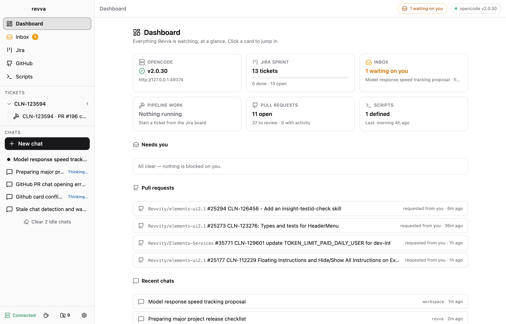
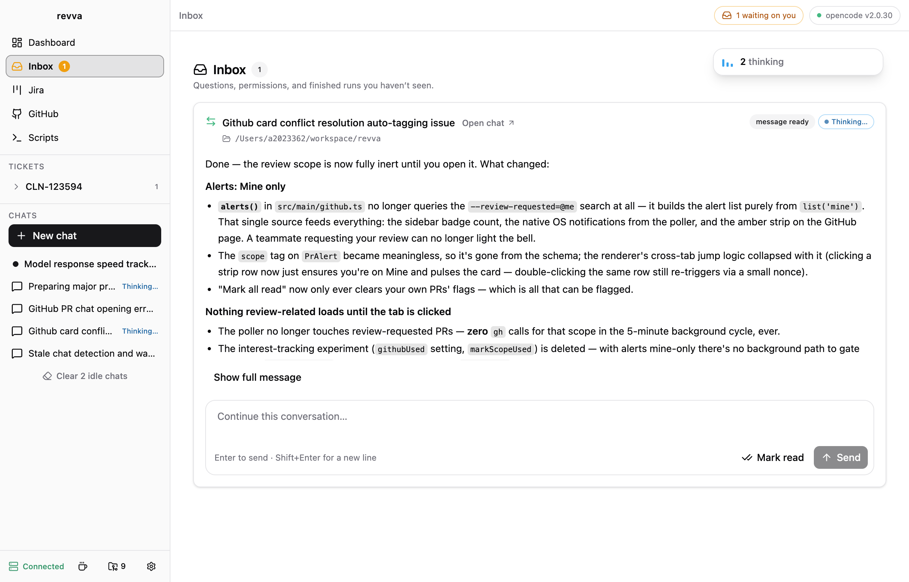
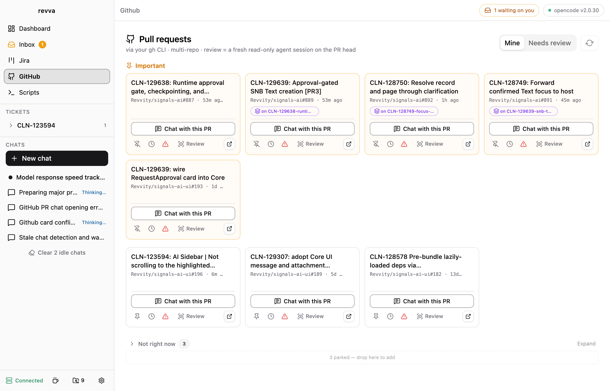
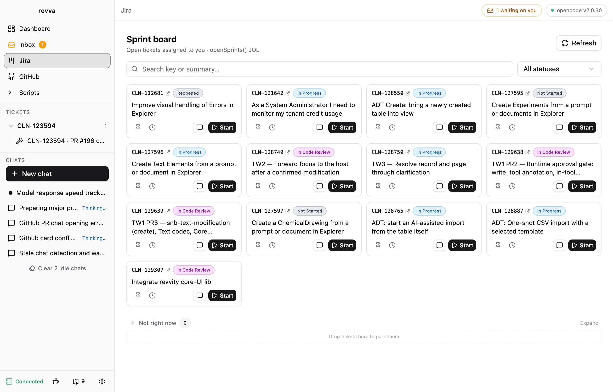
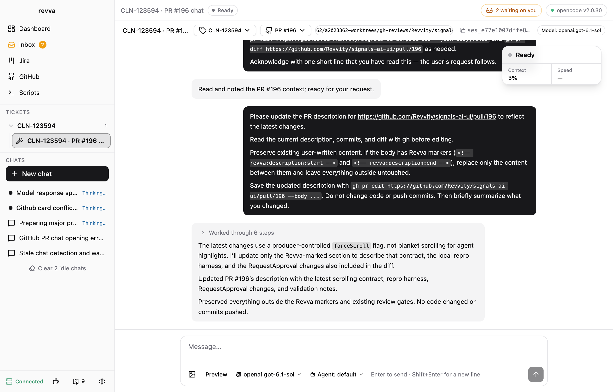
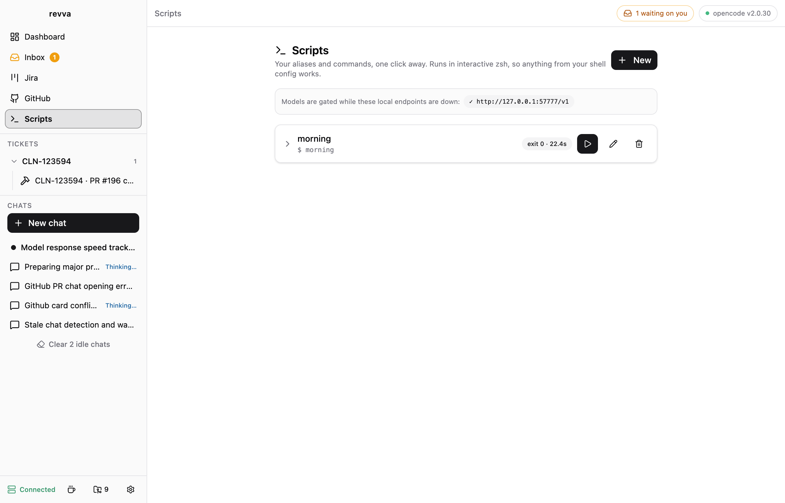

# revva

A local Electron desktop app that turns your Jira sprint into shipped, reviewed pull requests — driven by **opencode** sessions you control from one cockpit.

**[Download the latest release](https://github.com/adrian-revvity/revva/releases/latest)** — macOS (Apple Silicon DMG) and Windows (x64 installer).

<p align="center">
  
</p>

```
Jira sprint board ──▶ pick tickets ──▶ worktree + branch per ticket
        │                                    │
        │                              spin up opencode agent
        │                            (examples only; discover user's models)
        │                                    │
        │        ┌───────────────────────────┼───────────────────────────┐
        │        ▼                           ▼                           ▼
        │  /grill-me intake          main coding session        review fan-out
        │  (optional)                streaming output view      (sol-loop, test-audit,
        │        │                   answer pending questions   impeccable when UI) — parallel
        │        └───────────┬───────────────────────────────────────────┘
        │                    ▼
        └── status/comment ◀── PR + gh-stack + Jira transition
             sync ◀────────── "tackle new comments" rework agent
```

## Features

1. **Dashboard** — the landing view summarizes everything: OpenCode health, Jira sprint progress, inbox, active pipeline work, PRs needing attention, script status, recent chats. Every card deep-links into its view.
2. **Sprint board (Jira)** — fetches Jira issues assigned to you in the current sprint (via the Atlassian MCP server, using Revva's own OAuth connection — never another app's token cache). Tickets are compact drag-and-drop tiles: pin the ones that matter to **Important**, park the rest in the **Not right now** shelf.
3. **Start work** — creates a git worktree + branch per ticket in a workspace folder you pick (worktree root configurable), optionally **branching from another ticket's branch** (stacked work; the PR base follows the parent's branch, gh-stack-compatible). A **worktree cleanup** dialog lists every worktree across your repos, flags live ones, and removes stale ones safely — deletion previews exactly what it destroys and needs an explicit confirmation bound to the worktree's contents.
4. **Optional `/grill-me` phase** — before coding, the agent grills you about the ticket until the plan is solid; its output seeds the build.
5. **Agent/model selection everywhere** — every agent and model exposed by your OpenCode service is eligible. Per-role defaults (Sol-loop, test audit, UI review, fixer) live in Setup; any run can override each reviewer and the fixer individually. You can even **switch model or agent mid-conversation** — the next turn runs with the new pick, same history. Models whose provider needs a local endpoint are marked until that port is listening.
6. **Scripts** — add your own one-click shell scripts (aliases work; runs in interactive zsh), e.g. your `morning` AWS/SSO/proxy routine. Revva just runs them, streams output, and can probe a local port they open; it ships no AWS-specific logic.
7. **General chat** — a global **New Chat** action starts a normal OpenCode session with a chosen workspace directory, agent, and model — no Jira ticket or pipeline required. Chats are auto-titled from your first message, group under their ticket, and markdown renders while the answer streams. Chats show live context usage and streamed tokens/sec.
8. **Ticket cockpit** — live agent output (streaming text, tool calls collapsed per turn), follow-up composer, interrupt, and a shared transcript view. Agent messages render full markdown (GFM: tables, task lists, code blocks; links open in your browser).
9. **Triage inbox** — pending questions, permission requests, finished chats and ticket updates arrive as one queue you clear card by card, like email. Answer inline, reply to finished runs directly, or dismiss with Mark read. Near-simultaneous events raise a single OS notification, and a thinking meter counts what the agents are working on right now.
10. **Parallel review pipeline** — when the build finishes, revva fans out **concurrent read-only reviewers**: sol-loop protocol, test audit, and UI review (impeccable) only when UI files changed. Verdict protocol per reviewer; incomplete/errored reviewers block approval and skipped ≠ approved. Findings fan in to **one fixer** session, then bounded parallel re-review rounds (default 3, max 5). Live read-only transcripts per reviewer.
11. **Ship** — pre-flight checks (gh present/auth, GitHub remote, clean tree, commits ahead), `git push` (never force), `gh pr create` with a review-gate summary, opens the PR in your browser, then transitions Jira to a review-ish status and post a summary comment. revva never merges. Pushing/shipping is **opt-in per run** ("Push when changes are done"): when approved with a PR already linked, revva pushes to that PR; otherwise it opens one. In an ad-hoc session you can also just tell the agent "push when the changes are done".
12. **AUTO mode** — opt-in per run: the agent picks recommended/safe options, minimizes routine questions, and after all review gates pass revva pushes + opens the PR by itself. Genuine blockers park the work in WAITING_HUMAN with the reason; gates are never skipped and decisions are logged to an audit ledger.
13. **Comment watcher** — polls Jira for new comments on shipped tickets (excluding revva's own); a **"Tackle comments"** button runs a rework agent on the branch, pushes the fixes onto the open PR, and posts the agent's reply back to Jira.
14. **GitHub tab** — your open PRs (authored / review-requested) across all your projects via the `gh` CLI, as action-first tiles. **Chat with this PR** opens a conversation in a fitting folder without cloning; the **PR menu** carries review, conflict resolution, push, rebase, merge (GitHub still enforces its rules) and AI-updated PR descriptions; stacked PRs read as stacks (gh-stack-compatible). Alerts track only PRs you authored, with an unseen-updates strip that jumps to the card.
15. **Prompt tuning + favorites** — Setup holds per-role agent/model defaults (build, reviewers, fixer, PR review, PR description), editable prompt templates for every one-click button, and starred favorite models that pin to the top of every picker.
16. **Made for long runs** — a keep-awake toggle holds off Mac sleep while agents work; conversation switching never loses live output; idle chats clear in one sweep; abandoned work can be removed safely, merged branches included.

The same list is available in-app: **Setup → Features**.

## The views

<table>
  <tr>
    <td width="50%"></td>
    <td width="50%"></td>
  </tr>
  <tr>
    <td><b>Triage inbox</b> — questions, finished runs and PR updates as one card queue; answer or dismiss without leaving the view.</td>
    <td><b>GitHub</b> — open PRs as tiles you can pin, <i>Chat with this PR</i>, review, rebase and merge from Revva.</td>
  </tr>
  <tr>
    <td></td>
    <td></td>
  </tr>
  <tr>
    <td><b>Jira sprint board</b> — your tickets, one <i>Start flow</i> click from worktree + branch + agent.</td>
    <td><b>Conversations</b> — grouped tool steps, live model/agent switcher, one <code>PR #n</code> menu beside the transcript.</td>
  </tr>
  <tr>
    <td></td>
    <td></td>
  </tr>
  <tr>
    <td><b>Scripts</b> — your shell routines (e.g. <code>morning</code>) as one-click buttons with live output.</td>
    <td></td>
  </tr>
</table>

## Run Revva

From the project folder, install dependencies once and start the app:

```sh
pnpm install
pnpm dev
```

After the first install, just run `pnpm dev`. Leave the terminal running while
you use Revva; press `Ctrl+C` there to stop it. OpenCode must be installed for
agent features; Jira and GitHub can be connected as needed in Setup.

For quicker launches on macOS, add an alias to `~/.zshrc`, replacing the path
with your checkout's location (run `pwd` in the project folder to find it):

```sh
alias revva='cd /path/to/revva && pnpm dev'
```

Open a new terminal, then run `revva` from anywhere. This is a development
launch, not an installed app — for installers see Releases below.

## Releases & changelog

Versioning lives in `package.json` (semver); user-facing changes are recorded in
[CHANGELOG.md](CHANGELOG.md) under `[Unreleased]` as they happen.

To cut a release (from a clean `main`):

```sh
pnpm release:patch   # or release:minor / release:major
```

This bumps the version, seals the `[Unreleased]` changelog section under the new
version, commits, tags `vX.Y.Z`, and pushes. The tag triggers
`.github/workflows/release.yml`, which builds the macOS DMG + ZIP (arm64) and
the Windows NSIS installer + ZIP (x64) on GitHub runners and publishes them on
the [Releases page](https://github.com/adrian-revvity/revva/releases)
with the matching changelog section as release notes. Builds are unsigned for
now (Developer ID signing can be added later with `CSC_LINK` secrets) — the
first launch may need right-click → Open on macOS, and Windows SmartScreen
offers "More info → Run anyway".

Windows caveats: Jira OAuth, chats, pipelines and the GitHub tab all work
(tokens land in the Windows Credential store via `safeStorage`). The **Scripts
tab runs PowerShell instead of zsh** — shell aliases from your zsh config are
unix-side only, so define the command as a plain PowerShell command on Windows.
`opencode`, `git` and `gh` must be on `PATH`.

In-app: **Setup → v0.x.x → Changelog** shows the bundled changelog and links to
downloads.

## What it is not

Not a server platform. No Vercel/Neon, no sandboxes, no second agent runtime. revva is a local **cockpit over opencode**. It discovers each user's OpenCode models, agents, skills, and configuration; it does not assume the providers or files currently configured on the original developer's machine.

## Stack

- **Electron + electron-vite + React + TypeScript + Tailwind** — desktop shell and UI.
- **shadcn/ui** — component library for the renderer. Prefer existing components and compositions before creating custom UI (see [docs/FRONTEND.md](docs/FRONTEND.md)).
- **`@opencode/client`** (official TS client) + `@opencode/client/service` — discovers/starts the opencode background service and drives it over HTTP/SSE. revva does **not** spawn opencode per-session; it attaches to your shared service.
- **Atlassian MCP over Streamable HTTP** — Revva's own onboarding/OAuth flow (device/PKCE via loopback), tokens in Electron `safeStorage`. Optional documented fallbacks only. Never reads another app's private token-cache file.
- **better-sqlite3** — revva's own state: tickets↔sessions↔branches map, review ledger, decision audit log, comment-watch watermarks, role defaults, settings.
- **child_process** — feature-detected `git`, `gh`, and user scripts (`/bin/zsh -ic`), with in-app status/errors.

## Repo layout

```
revva/
├── electron.vite.config.ts
├── components.json                # hand-maintained shadcn/ui config (CLI can't detect electron-vite)
├── src/
│   ├── main/                      # Electron main process = the "engine"
│   │   ├── opencode/              #   service attach (service.ts), SSE bus, chats, inbox mirror, inventory
│   │   ├── jira/                  #   OAuth (auth.ts), MCP client (mcp.ts), board queries, comment watcher (watch.ts)
│   │   ├── pipeline/works.ts      #   work state machine: worktree/branch/build session + review hooks
│   │   ├── review.ts              #   M4: parallel reviewer fan-out, fan-in fixer, bounded rounds
│   │   ├── ship.ts                #   M5: pre-flight checks, push, gh pr create, Jira sync, AUTO ship
│   │   ├── scripts.ts             #   user one-click scripts (aliases via interactive zsh) + port probes
│   │   ├── ipc.ts                 #   typed IPC surface (zod-validated in main only)
│   │   └── db/                    #   better-sqlite3 schema + settings/role-config helpers
│   ├── preload/                   # typed contextBridge API surface (one `revva` global; zod-free)
│   ├── shared/                    # IPC contract: channel names + zod types shared by main/renderer
│   └── renderer/src/views/        # React UI: Board, Cockpit, Inbox, Scripts, Chats, Setup + dialogs
└── docs/
    ├── REQUIREMENTS.md            # reusable product/setup requirements and acceptance criteria
    ├── FRONTEND.md                # shadcn/ui choice, reuse-first policy, component map
    ├── ARCHITECTURE.md            # components, API surface used, data model
    ├── PIPELINE.md                # the ticket state machine in detail
    └── MILESTONES.md              # build order + owner notes
```

## Integration notes (verified against this local setup, 2026-10-28; local values are examples, not requirements)

| Fact | Evidence |
| --- | --- |
| opencode background service with HTTP API | registration file + `/api/info`; revva auto-attaches or starts one |
| Pending agent questions = **forms**; `form.created` events carry `data.form` | SSE stream (live-only, no replay — revva resyncs on reconnect) |
| Completion signal: `session.execution.succeeded/failed/interrupted` | `session.idle` does NOT fire over SSE |
| Permission prompts: `permission.asked` (fields directly on `data`) | SSE stream |
| Worktree API exists; revva uses plain `git worktree add` for predictability | verified live |
| Model selection per session: `session.create({model:{providerID,id}, location:{directory}})` | verified live |
| Real MCP tool names: `searchJiraIssuesUsingJql`, `getJiraIssue`, `addCommentToJiraIssue`, `transitionJiraIssue`, `getTransitionsForJiraIssue`, `atlassianUserInfo`; all require `cloudId`; there is **no** list-comments tool (comments come from `getIssue` fields) | live `tools/list` |
| Original developer's `morning` zsh function calls `useaws.py` and starts a proxy | Local observation only; added as a user **Script** in Revva — Revva runs it and probes its local port, nothing AWS-specific in code |
| Original developer has GPU, Bedrock, and Kimi providers configured | Local observation only; Revva discovers agents/models dynamically and makes none a requirement |
| Original developer has `grill-me`, `test-audit`, `impeccable`, and `gh-stack` installed | Local observation only; Revva checks skills/extensions per installation |

## Requirements

See [docs/REQUIREMENTS.md](docs/REQUIREMENTS.md) for reusable-app requirements, first-run setup, optional integration prerequisites, the scripts feature, role-based agent/model selection, general chat, AUTO behavior, security, and acceptance criteria.

## Build order

See [docs/MILESTONES.md](docs/MILESTONES.md). Each milestone is independently usable.
